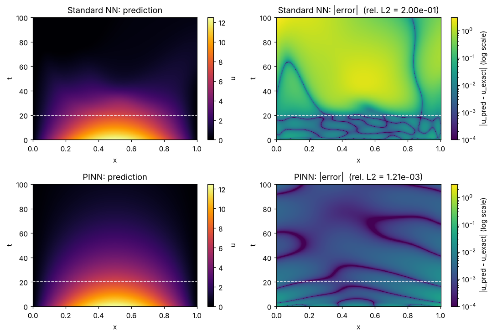
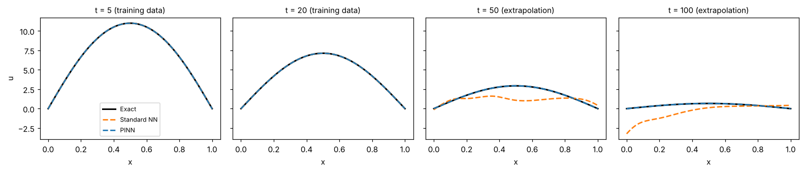
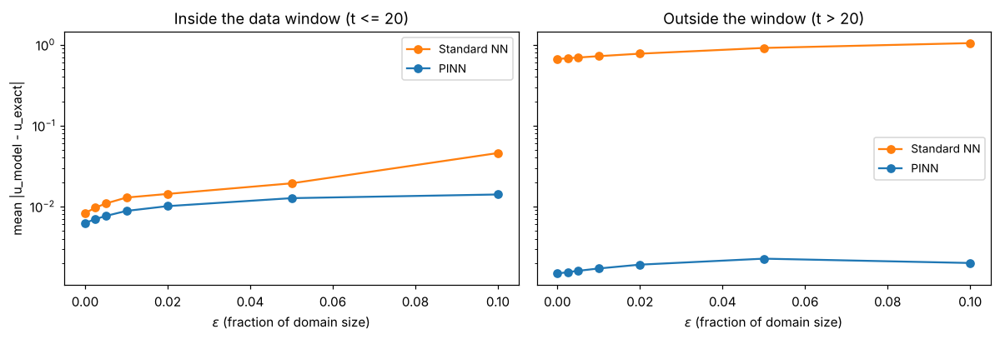

# Physics-Informed Neural Networks: 1-D Heat Equation

A small, self-contained PyTorch example of a **physics-informed neural network (PINN)**, and of how it differs from an ordinary neural network when data runs out.

The problem is the 1-D heat equation with a known exact solution:

```
u_t = k u_xx,    0 < x < 1,  0 < t < 100,  k = 0.003
u(0, t) = u(1, t) = 0
u(x, 0) = 50 x (1 - x)
```

| Notebook | What it does |
|---|---|
| [`01_heat_equation_pinn.ipynb`](01_heat_equation_pinn.ipynb) | Trains a standard network on observations from the early-time window (`t <= 20`) and a PINN with **no interior observations at all**, then compares both with the exact solution. |
| [`02_pinn_robustness_fgsm.ipynb`](02_pinn_robustness_fgsm.ipynb) | Loads the two trained models and attacks their inputs with the Fast Gradient Sign Method (FGSM) to see how their error grows. |

Both notebooks are saved with their outputs, so they can be read directly on GitHub.

## Results

Relative L2 error against the exact solution on a 501 x 501 grid:

| Model | `t <= 20` (training data) | `t > 20` (extrapolation) | Whole domain |
|---|---|---|---|
| Standard NN | 1.6e-3 | 3.7e-1 | 2.0e-1 |
| PINN | 1.3e-3 | 9.2e-4 | 1.2e-3 |

The standard network fits the data it was shown and then fails outside that window. The PINN follows the heat equation across the whole domain, because the PDE residual constrains it at 4000 random collocation points.





Under a one-step FGSM attack (inputs moved by up to 10% of the domain in the direction that increases the model's true error), the standard network's error inside its data window grows 5.5 times; the PINN's grows 2.2 times. Outside the window the PINN's error stays about 500 times lower. See the second notebook for the details and caveats.



## The PINN loss

```
L = mean (u(x, 0) - 50x(1-x))^2                  initial condition
  + mean u(0, t)^2 + mean u(1, t)^2              boundary conditions
  + lambda * mean (u_t - k u_xx)^2               PDE residual at collocation points
```

`u_t` and `u_xx` are obtained by automatic differentiation of the network with respect to its `(x, t)` inputs (`heat_residual` in `heat_pinn.py`). The residual is multiplied by the time span (100) so that its magnitude is comparable with the other terms.

## Repository layout

```
01_heat_equation_pinn.ipynb       training and comparison
02_pinn_robustness_fgsm.ipynb     adversarial robustness test
heat_pinn.py                      model, exact solution, PDE residual, metrics, plotting
models/                           trained weights written by notebook 1, read by notebook 2
figures/                          figures written by the notebooks
requirements.txt
```

## Running it

```bash
pip install -r requirements.txt
jupyter notebook
```

Run `01_heat_equation_pinn.ipynb` first (about 2 minutes on a laptop CPU). It writes `models/standard_nn.pt` and `models/pinn.pt`, which the second notebook needs. The committed weights let you run the second notebook on its own.

## Design choices worth knowing

* **Observation window.** The standard network only sees data for `t <= 20` (`T_DATA_MAX` in notebook 1). With observations over the whole domain there is nothing for the PINN to add. Change the constant to see how the comparison shifts.
* **Collocation points** are drawn at random over the whole domain rather than on a grid, so the residual is not tied to a fixed lattice.
* **Weights** are saved as `state_dict` plus the architecture config and loaded with `weights_only=True`, so nothing is unpickled.
* **FGSM target.** For regression the attack maximises the model's squared error against the *exact solution at the perturbed point*, using a differentiable copy of the series solution. Measuring only how far the output moves would not be informative, because the true solution moves too.

## Reference

M. Raissi, P. Perdikaris and G. E. Karniadakis, *Physics-informed neural networks: A deep learning framework for solving forward and inverse problems involving nonlinear partial differential equations*, Journal of Computational Physics 378 (2019).
